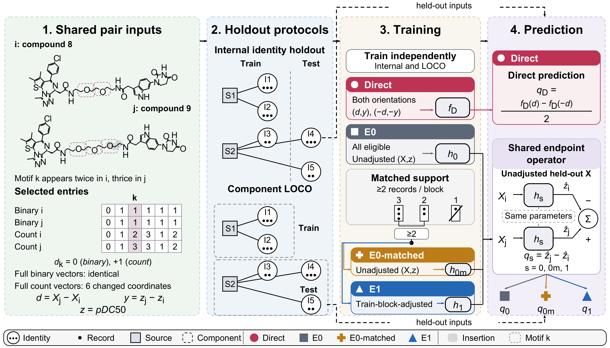

# Predicting PROTAC Potency Differences

Code and analysis results for **Predicting PROTAC Potency Differences: A Comparison of Pairwise and Endpoint Learning**.

The study compares direct prediction of signed potency differences with subtraction of two endpoint predictions. It examines training-record support, binary versus unfolded count Morgan representations, and identity-based versus source-component holdout. The main dataset contains 699 records, 511 molecular identities and 5,804 compatible pairs. The component analysis evaluates 43 components containing eligible pairs. Retrospective BRD4 and RIPK1 cases are reported separately from this component evaluation.



Figure 1 appears in the main article and shows the shared signed-pair target, the two holdout protocols, and the Direct, E0, E0-matched, and E1 learning strategies.

## Contents

| Location | Contents |
|---|---|
| `code/core/` | Identity-based internal evaluation, source-holdout model code and shared numerical helpers |
| `code/data_build/` | Local input preparation from reader-acquired source material |
| `code/source_components/` | Source-component holdout, inner calibration and candidate selection |
| `code/objective_sensitivity/` | Fixed Ridge sensitivity to inner selection/calibration objectives |
| `code/fixed_prediction_diagnostics/` | Conditional slope intervals from saved predictions |
| `code/external_cases/` | BRD4/RIPK1 compound and pair mappings, fixed-model inference and ensemble point estimates |
| `results/` | 69 aggregate/resampling files and 8 compressed prediction tables, without source measurements or structures |
| `data/` | Source access and input requirements |

The [result-file guide](docs/result-files.md) identifies the analyses represented by the supplied tables. The main article and Supporting Information describe the methods and scientific interpretation.

## Setup and data preparation

Use Python 3.11.15 in an isolated environment. The recorded scientific package versions are in [requirements.txt](requirements.txt) and [scientific_config.json](code/core/scientific_config.json). From the repository root:

```sh
python -m venv ../protac-env
# Activate that environment using the command for your operating system.
python -m pip install -r requirements.txt
```

XGBoost training requires a compatible NVIDIA CUDA device, as the model implementation rejects CPU fallback. Input reconstruction and inspection do not require model fitting. A fresh environment installation and the complete training study were not repeated when packaging this repository.

The upstream TACK DC50 snapshot is obtained from its original host and is not mirrored here. Source records, measured activities, and manually transcribed molecular structures are subject to their original terms. See [data access](data/README.md) for the specified source, local reconstruction route, and remaining input limitations.

The code accepts explicit local input and output paths. Keep source downloads and reconstructed record-level data outside this checkout. Inspect the documented input checks before running model fitting; the training commands are not lightweight demonstrations. Each analysis directory describes its entry point and required files.

After separately obtaining the specified TACK snapshot, reconstruct and inspect the main-analysis inputs:

```sh
python code/data_build/reconstruct.py --snapshot ../TACK_DC50.parquet --output ../protac-inputs
python code/core/portable.py inspect --manifest ../protac-inputs/inputs.json
```

The [reconstruction instructions](code/data_build/README.md) document the source identity and the checked 699-record / 5,804-pair input population. Continue with the [source-component analysis](code/source_components/README.md), [identity/source sensitivity analyses](code/core/README.md), [Ridge objective sensitivity](code/objective_sensitivity/README.md), or [fixed-prediction slope diagnostics](code/fixed_prediction_diagnostics/README.md); the slope-diagnostics route joins the supplied prediction files to locally reconstructed labels and requires no model training. The [external-case instructions](code/external_cases/README.md) provide source compound/opaque ID mappings, local input schemas, model-cache formation routes, and inference and ensemble calculations. Readers must curate the complete case structures and measurements locally; fitted model files are not supplied, and fresh end-to-end case reproduction was not run when packaging this repository.

The supplied aggregate results can be inspected directly. The complete model-training study was not repeated when packaging this repository. Reproducing a calculation requires the corresponding source inputs, predefined assignments, and, where indicated, saved prediction caches; providing the source code does not establish that unavailable third-party materials have been recovered.

## Interpretation

All comparisons use the definitions and populations stated in the article. The source-component units are operational source/shared-identity groups and do not guarantee complete independence between publications, patent families, or chemical series. The external cases are retrospective single-source checks. The Ridge objective sensitivity is posthoc, and the slope intervals are conditional on saved predictions. These analyses do not establish a universal ranking of learning strategies or prospective clinical or experimental performance.

## License and source terms

The [MIT License](LICENSE) applies to author-written code and accompanying software documentation. Third-party software and data are subject to their own terms; the code license does not grant rights to redistribute upstream records or molecular structures. See [licensing and source terms](docs/licensing.md).
